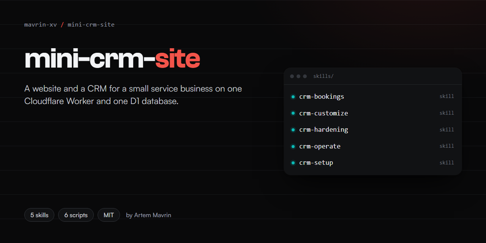

# mini-crm-site

**A website and a CRM for a small service business on one free Cloudflare Worker and one D1 database: the form saves the lead, the operator moves it across a board, and nobody waits two days for a call back.**

Leads from the site land in an inbox nobody checks, a spreadsheet nobody updates, or a paid CRM that is overkill for one person answering the phone.

[](LICENSE)


```bash
git clone https://github.com/mavrin-xv/mini-crm-site && cd mini-crm-site
./install.sh  # or: ./install.sh --project
```

<!-- install-notes:start -->
Other ways in: as a Claude Code plugin, run `/plugin marketplace add mavrin-xv/mini-crm-site` and then `/plugin install mini-crm-site@mini-crm-site`. For Codex or another agent that reads `SKILL.md`, copy the folders under `skills/` into its skills directory. On Windows, run `install.sh` from Git Bash or WSL and type `py -3` where these docs say `python3`.
<!-- install-notes:end -->

Then open the folder in your agent and say "set up the CRM".

---

## What it solves

| Pain | Fix in this repo |
|---|---|
| Form submissions go to email and get lost | Every lead is a row in D1 before the visitor sees "thanks"; alerts are a copy, not the record |
| Nobody knows which leads are still open | Board with columns new, contacted, quoted, booked, done, lost, spam, plus notes and a change log |
| Leads wait hours for a first call | Alert on arrival, a second alert if nobody touched it within the SLA, daily digest |
| Double taps create duplicate leads | Dedup by phone and service inside 30 minutes |
| Bots fill the form | Honeypot, per-IP rate limit (hashed), optional Turnstile |
| "Where do our leads come from?" | UTM fields captured from the URL; weekly report by source, speed to first contact, stale leads |
| Hand-rolled Workers leak customer data | Static audit and a live probe that flags public read endpoints, default passwords, tokens in HTML |
| Same crew booked twice | Bookings add-on with holds, a 409 on overlap and an overlap checker |

## What's inside

| Skill | What it does | Say |
|---|---|---|
| `crm-setup` | Deploys the template to a live URL and proves it with an 18-check smoke test | "set up the CRM", "deploy it to Cloudflare" |
| `crm-customize` | Changes services, statuses, fields and landing copy without breaking the database, form and board sync | "add a field for square meters", "rename the services" |
| `crm-operate` | Daily routine, weekly pipeline report, speed-to-lead and stale-lead rules | "weekly lead report", "which leads are stuck" |
| `crm-hardening` | Security and QA audit of this or any lead Worker, static scan plus live probe | "is my CRM secure", "audit before launch" |
| `crm-bookings` | Adds time-slot bookings with expiring holds and finds double bookings | "add bookings", "we got double-booked" |

Also: `app/` (the working template, 20 offline tests), `templates/` (bookings add-on), `examples/` (sample data, a deliberately broken Worker for the audit), `docs/architecture.md`.

## Quick start

```bash
cd app
node --no-warnings test/run.mjs                  # 20 passed, no account needed
npx wrangler d1 create crm                       # paste the id into wrangler.toml (from wrangler.toml.example)
npx wrangler d1 migrations apply crm --remote
npx wrangler secret put ADMIN_PASSWORD
npx wrangler secret put SESSION_SECRET
npx wrangler secret put TG_BOT_TOKEN && npx wrangler secret put TG_CHAT_ID
npx wrangler deploy
python3 ../skills/crm-setup/scripts/smoke_test.py https://<your-worker>.workers.dev --password '<ADMIN_PASSWORD>'
```

Try it without deploying: `npx wrangler dev`, then open `http://localhost:8787` and `/admin`.

## How it works

```text
visitor ─ form ─► POST /api/lead ─► checks (honeypot, Turnstile, validate, rate limit)
                                     │
                                     ├─► D1: contact (by phone) + lead + 'created' event
                                     ├─► 200 to visitor
                                     └─► waitUntil: Telegram / webhook ─► notify_ok | notify_fail

operator ─ /admin ─► signed cookie ─► board: status, value, follow-up, notes, history

cron every 15 min ─► lead untouched past SLA in work hours ─► one reminder
                  └► DIGEST_HOUR local ─► yesterday's leads, open count, overdue follow-ups

weekly ─► wrangler d1 export ─► report.py ─► by source, speed to lead, stale, win rate
```

Two rules carry the design. The database is the record and alerts are best effort, so a broken bot never loses a lead. Every list (services, statuses) lives in `config.js`, is enforced by a CHECK in the database, and `check_config.py` fails if the two drift.

## Configure

| Setting | Where | Default |
|---|---|---|
| Business name, currency, timezone | `app/src/config.js` `BUSINESS` | Northwind Cleaning (invented), USD, America/Chicago |
| Services on the form | `config.js` `SERVICES` + `public/index.html` | regular, deep, move-out, office |
| Statuses | `config.js` `STATUSES` + migration CHECK | new, contacted, quoted, booked, done, lost, spam |
| Work hours, SLA, digest hour | `config.js` | 8 to 20, 15 minutes, 8:00 |
| Login | secrets `ADMIN_PASSWORD`, `SESSION_SECRET` | none (admin returns 503 until set) |
| Alerts | secrets `TG_BOT_TOKEN` + `TG_CHAT_ID`, and/or `NOTIFY_WEBHOOK_URL` | none |
| Bot check | secret `TURNSTILE_SECRET` + site key in the page | off |
| Board link in alerts | `[vars] PUBLIC_URL` | empty |

## Honest limits

- One shared operator password. Several named users need a `users` table (sketched in `docs/architecture.md`).
- No email sending, no SMS, no calendar sync. The webhook hands off to a tool that does those.
- The free tier is plenty for a small business (Cloudflare's published D1 and Workers limits are in `skills/crm-setup/references/deploy-steps.md`), but check the current numbers before you rely on them.
- D1 has no row locks. The bookings add-on re-checks after insert; very busy public booking needs a Durable Object.
- Tested: 20 offline tests and 8 bookings tests on Node's built-in SQLite, the 18-check smoke test and the UI against `wrangler dev` locally. Not tested by us: a real deploy to a Cloudflare account, real Telegram delivery, Turnstile, the cron on Cloudflare's scheduler.
- Tested with Claude Code. Other agents that read SKILL.md files should work; not tested.

## Credits

- Cloudflare's agent skills https://github.com/cloudflare/skills (Apache-2.0): Workers and D1 conventions, wrangler command order. Idea only, no text copied.
- https://github.com/crmkit/crmkit (MIT): append-only activity log per record, reminders as data. Idea only.
- https://github.com/cloudflare/d1-northwind (MIT): one-database layout with schema and seed scripts as separate files.
- Form pipeline order (honeypot, bot check, validate, save, then notify) follows common Workers form handlers such as the Astro forms examples on npm; no code copied.
- Speed-to-lead background: Oldroyd, McElheran, Elkington, "The Short Life of Online Sales Leads", Harvard Business Review, March 2011, https://hbr.org/2011/03/the-short-life-of-online-sales-leads.

## Contributing

See `CONTRIBUTING.md`. Coding agents should read `AGENTS.md` first.

<!-- author:start -->
## Author

Built and maintained by [Artem Mavrin](https://github.com/mavrin-xv). This repo is one of a set of agent skill packs for marketing and operations work. Each one installs on its own; the full list is in [agent-skill-packs](https://github.com/mavrin-xv/agent-skill-packs). If a pack saved you an afternoon, a star helps other people find it.
<!-- author:end -->

## License

MIT, see `LICENSE`.
